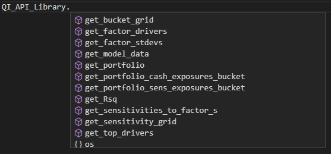

# Qi API

This repository includes some examples of how to use Quant-Insight's API. 

It contains four main folders:

  * 1.Built_In_Functions: contains the API's built-in functions.
  * 2.Pull_Data: contains useful examples of how to pull the data from Qi's database. 
  * 3.Use_Cases: examples of how Qi data is used.
  * 4.Macro Risk: a comprehensive guide on how to calculate your portfolio's macro risk.

## What do you need to start using the API?

* **Python 3.12 or newer.** If you install with uv (recommended, see below), uv will download a suitable Python for you.
* **Client download token.** This is unique to your organisation and is required to install the Qi client (`qi-client`).
* **API key.** This is required to call the API. If you don't have one yet, please contact Quant-Insight.

> **Keep your token and API key out of your code.** Set them as environment variables (as shown below) rather than typing them into scripts or notebooks, so they can never be committed to a repository by accident. The repository's `.gitignore` blocks common secret files such as `.env`, but it cannot detect a key written inside a `.py` or `.ipynb` file.

## Installation

All dependencies, including `qi-client`, are pinned to exact, tested versions in `requirements.txt`. Jupyter is not included; if you want to use notebooks, install it separately into the same environment (for example `uv pip install notebook`), or use VS Code's built-in notebook support.

### Option 1 (recommended): uv

[uv](https://docs.astral.sh/uv/) is a fast Python package manager. It can install the correct Python version for you, and by default it will only install `qi-client` from Quant-Insight's package index, which protects against look-alike packages published on public PyPI.

1. Install uv by following the [installation guide](https://docs.astral.sh/uv/getting-started/installation/).

2. Download this repository and move into it:

        git clone https://github.com/Quant-Insight/Qi_API.git
        cd Qi_API

3. Create and activate a virtual environment:

        uv venv --python 3.12

        source .venv/bin/activate          # macOS / Linux
        .venv\Scripts\activate             # Windows

4. Set your client download token and install the dependencies:

        export QI_DOWNLOAD_TOKEN=YOUR_TOKEN            # macOS / Linux
        set QI_DOWNLOAD_TOKEN=YOUR_TOKEN               # Windows (Command Prompt)
        $env:QI_DOWNLOAD_TOKEN="YOUR_TOKEN"            # Windows (PowerShell)

        uv pip install -r requirements.txt

### Option 2: venv and pip

Use this if you can't install uv, for example on a locked-down machine. It needs Python 3.12 or newer to be installed already.

1. Check your Python version first. On an older version, the install fails with an error that doesn't mention the Python version:

        python3 --version                  # macOS / Linux
        python --version                   # Windows

    If it shows anything below 3.12, install Python 3.12 or newer from [python.org](https://www.python.org/downloads/), then use that version explicitly in the next step: `python3.12 -m venv .venv` on macOS / Linux, or `py -3.12 -m venv .venv` on Windows.

2. Download the repository, create the environment and install:

        git clone https://github.com/Quant-Insight/Qi_API.git
        cd Qi_API

        python3 -m venv .venv                  # Windows: python -m venv .venv
        source .venv/bin/activate              # Windows: .venv\Scripts\activate

        export QI_DOWNLOAD_TOKEN=YOUR_TOKEN    # Windows: see the commands in Option 1, step 4
        pip install -r requirements.txt

3. If you want to use Jupyter notebooks, install Jupyter into the same environment:

        pip install notebook

### Troubleshooting: "qi-client not found"

If the install stops with an error saying `qi-client` was not found, the most likely cause is that `QI_DOWNLOAD_TOKEN` is not set in the terminal you are installing from. uv and pip don't mention the token in this error. Check it with `echo $QI_DOWNLOAD_TOKEN` (macOS / Linux) or `echo $env:QI_DOWNLOAD_TOKEN` (PowerShell), set it if it is empty, and run the install again. Environment variables only last for the terminal window they were set in.

If you used uv, always install with `uv pip`, not `pip`: a uv environment doesn't include pip, so a plain `pip` command installs into a different Python on your machine.

### Hosted notebooks (no terminal access)

If you work in a hosted Jupyter environment, run this in a notebook cell. The token is typed into a prompt and is not saved in the notebook:

    import os, getpass
    os.environ['QI_DOWNLOAD_TOKEN'] = getpass.getpass('Qi download token: ')
    %pip install -r requirements.txt

## Setting your API key

Set your API key as the environment variable `QI_API_KEY` **before** starting Python or Jupyter:

    export QI_API_KEY=YOUR_API_KEY         # macOS / Linux
    set QI_API_KEY=YOUR_API_KEY            # Windows (Command Prompt)
    $env:QI_API_KEY="YOUR_API_KEY"         # Windows (PowerShell)

If you use Jupyter, start it from the same terminal (`jupyter notebook` or `jupyter lab`) so that it can see the key.

**VS Code:** notebooks and scripts run inside VS Code don't see variables set in a terminal. Instead, create a file called `.env` in the repository folder containing:

    QI_API_KEY=YOUR_API_KEY
    QI_DOWNLOAD_TOKEN=YOUR_TOKEN

(no quotes, no spaces around `=`). VS Code loads it automatically; restart the notebook kernel after creating it. The `.gitignore` in this repository stops `.env` from being committed.

If you can't set environment variables (for example in a hosted notebook), enter the key at a prompt at the start of your notebook instead. This keeps it out of the saved file:

    import os, getpass
    os.environ['QI_API_KEY'] = getpass.getpass('Qi API key: ')

## How to use the Qi wrapper

`Qi_wrapper.py` provides ready-made functions for Qi's main use cases. It reads your API key from `QI_API_KEY` when it is imported, so set the key first (see above).

Start Python or Jupyter from the repository folder so that `Qi_wrapper.py` can be found, then:

    import Qi_wrapper as qi

    # Top 5 macro drivers for Apple on a given date
    qi.get_top_drivers('AAPL', 5, '2026-10-27', 'Long Term')

    # R-squared history over a date range
    qi.get_Rsq('AAPL', '2026-01-01', '2026-10-27', 'Long Term')

Most functions take a model name, a date (or start and end dates) and a term (`'Long Term'` or `'Short Term'`), and return a pandas DataFrame. If you see `Mandatory environment variable QI_API_KEY not set!` when importing, the key was not set in the session you started Python from.

The full list of use case functions:
                         
                        
                         

## Using the Qi client directly

If you prefer to call the API without the wrapper, read the key from the environment rather than writing it into your script:

    import os
    import pandas
    import qi_client
    from qi_client.rest import ApiException

    configuration = qi_client.Configuration()
    configuration.api_key['X-API-KEY'] = os.environ['QI_API_KEY']

    api_instance = qi_client.DefaultApi(qi_client.ApiClient(configuration))

All the example scripts in this repository read the key from `QI_API_KEY` in the same way, so you never need to paste your key into them.
